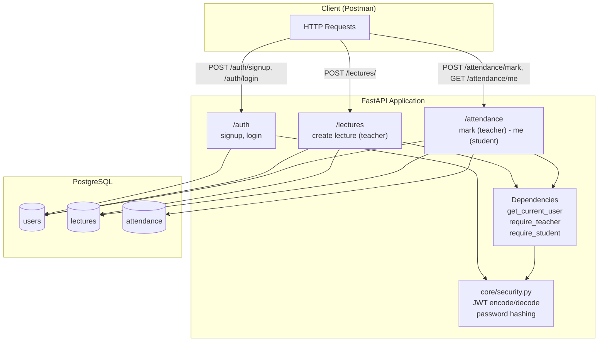
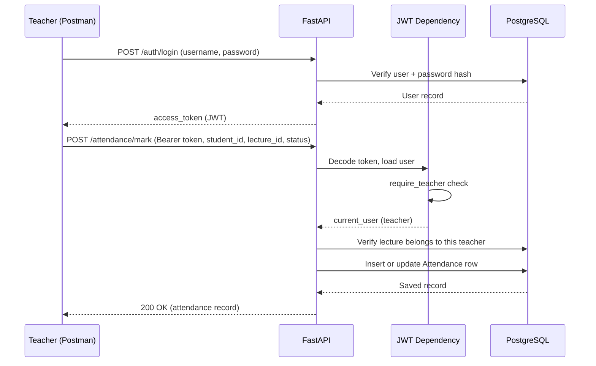
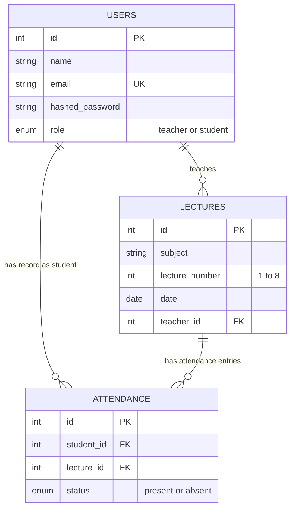

# Student Attendance Service

A backend service built with **FastAPI**, **SQLAlchemy**, and **PostgreSQL** to manage student attendance across daily lectures. Teachers can mark attendance for lectures they conduct; students can view their own attendance history. Access is controlled via **JWT-based authentication** with role-based permissions.

---

## Table of Contents

1. [Overview](#overview)
2. [Architecture](#architecture)
3. [Tech Stack](#tech-stack)
4. [Project Structure](#project-structure)
5. [Database Schema](#database-schema)
6. [Setup — Step by Step](#setup--step-by-step)
7. [Running the Server](#running-the-server)
8. [API Reference](#api-reference)
9. [Testing the Full Flow (Postman)](#testing-the-full-flow-postman)
10. [Common Errors & Fixes](#common-errors--fixes)

---

## Overview

- There are up to **8 lectures per day**, each with a subject, a lecture number, a date, and a teacher.
- **Teachers** can create lectures and mark students present/absent for lectures they personally teach.
- **Students** can view only their own attendance records.
- All endpoints (except signup/login) require a valid **JWT bearer token**, and access is restricted by role.

---

## Architecture



**Request flow for marking attendance:**



---

## Tech Stack

| Layer          | Technology                          |
|----------------|--------------------------------------|
| Language        | Python 3.14                          |
| Framework       | FastAPI                              |
| ORM             | SQLAlchemy                           |
| Database        | PostgreSQL                           |
| Auth            | JWT (python-jose) + OAuth2 password flow |
| Password hashing| passlib (bcrypt)                     |
| Validation      | Pydantic v2                          |
| Server          | Uvicorn                              |
| Testing         | Postman                              |

---

## Project Structure

```
attendance-service/
├── app/
│   ├── core/
│   │   ├── dependencies.py    # get_current_user, require_teacher, require_student
│   │   └── security.py        # password hashing, JWT create/decode
│   ├── models/
│   │   ├── user.py            # User model + RoleEnum
│   │   ├── lecture.py         # Lecture model
│   │   └── attendance.py      # Attendance model + StatusEnum
│   ├── routers/
│   │   ├── auth.py            # /auth/signup, /auth/login
│   │   ├── lecture.py         # /lectures/
│   │   └── attendance.py      # /attendance/mark, /attendance/me
│   ├── schemas/
│   │   ├── user.py            # UserCreate, UserOut, Token
│   │   ├── lecture.py         # LectureCreate, LectureOut
│   │   └── attendance.py      # MarkAttendanceRequest, AttendanceOut, LectureAttendanceOut
│   ├── database.py            # Engine, SessionLocal, get_db
│   └── main.py                # App entrypoint, router registration
├── postman_collection.json    # Exported Postman collection for testing
├── requirements.txt
├── .env                        # Not committed - holds secrets
├── .gitignore
└── README.md
```

---

## Database Schema



A **unique constraint** on `(student_id, lecture_id)` in the `attendance` table ensures one attendance record per student per lecture (re-marking updates the existing row instead of duplicating it).

---

## Setup — Step by Step

### 1. Clone the repository

```bash
git clone https://github.com/<your-username>/attendance-service.git
cd attendance-service
```
**Result:** Project files are copied to your machine.

### 2. Create and activate a virtual environment

```bash
python3 -m venv venv
source venv/bin/activate
```
**Result:** Your shell prompt changes to show `(venv)`, confirming the virtual environment is active. All Python packages installed from here on stay isolated from your system Python.

### 3. Install dependencies

```bash
pip install -r requirements.txt
```
**Result:** FastAPI, SQLAlchemy, Uvicorn, python-jose, passlib, python-dotenv, and other listed packages are installed into `venv/`.

> **Note:** If you hit `ImportError: email-validator is not installed`, run:
> ```bash
> pip install 'pydantic[email]'
> ```
> This is needed because Pydantic's `EmailStr` type depends on it separately.

> **Note:** If you hit `ValueError: password cannot be longer than 72 bytes` during signup, it's a known incompatibility between `passlib` and newer `bcrypt` releases. Fix it by pinning an older bcrypt version:
> ```bash
> pip install "bcrypt==4.0.1"
> ```

### 4. Set up PostgreSQL

Make sure PostgreSQL is installed and running, then create the database:

```bash
psql -U postgres -c "CREATE DATABASE attendance_db;"
```
**Result:** An empty `attendance_db` database is created. The application will create tables inside it automatically on first run (no manual migrations needed for this project).

### 5. Configure environment variables

Create a `.env` file in the project root:

```bash
cat > .env << 'EOF'
DATABASE_URL=postgresql://<db_user>:<db_password>@localhost:5432/attendance_db
SECRET_KEY=<your-random-secret-key>
ALGORITHM=HS256
ACCESS_TOKEN_EXPIRE_MINUTES=2880
EOF
```
**Result:** A `.env` file is created holding the DB connection string and JWT settings. This file is listed in `.gitignore` and is never committed.

---

## Running the Server

```bash
uvicorn app.main:app --reload
```

**Expected result:**
```
INFO:     Will watch for changes in these directories: [...]
INFO:     Uvicorn running on http://127.0.0.1:8000
INFO:     Application startup complete.
```

**Explanation:** `Base.metadata.create_all(bind=engine)` in `main.py` runs on startup and creates the `users`, `lectures`, and `attendance` tables in PostgreSQL if they don't already exist. `--reload` restarts the server automatically whenever you edit a file — useful during development.

Verify it's alive:

```bash
curl http://127.0.0.1:8000/health
```
**Expected result:** `{"status":"ok"}`

---

## API Reference

| Method | Endpoint             | Access        | Request Body                                       | Description                                      |
|--------|-----------------------|---------------|------------------------------------------------------|---------------------------------------------------|
| POST   | `/auth/signup`         | Public        | `{name, email, password, role}`                       | Register as `teacher` or `student`                 |
| POST   | `/auth/login`          | Public        | form-urlencoded: `username`, `password`               | Returns `{access_token, token_type}`                |
| POST   | `/lectures/`           | Teacher only  | `{subject, lecture_number, date}`                     | Create a lecture (linked to the logged-in teacher) |
| POST   | `/attendance/mark`     | Teacher only  | `{student_id, lecture_id, status}`                    | Mark/update a student's attendance for a lecture    |
| GET    | `/attendance/me`       | Student only  | —                                                      | View your own attendance across all lectures        |
| GET    | `/health`              | Public        | —                                                      | Health check                                        |

All protected routes require the header:
```
Authorization: Bearer <access_token>
```

---

## Testing the Full Flow (Postman)

### 1. Sign up a teacher

```
POST http://127.0.0.1:8000/auth/signup
Content-Type: application/json

{
  "name": "Ms. Sharma",
  "email": "teacher1@test.com",
  "password": "teacher123",
  "role": "teacher"
}
```
**Result:** `200 OK`, returns the created user with `id`, `name`, `email`, `role` (password is never returned).

### 2. Sign up a student

```
POST http://127.0.0.1:8000/auth/signup
Content-Type: application/json

{
  "name": "Rahul",
  "email": "student1@test.com",
  "password": "student123",
  "role": "student"
}
```
**Result:** `200 OK`, same shape as above, with `role: "student"`.

### 3. Log in as the teacher

```
POST http://127.0.0.1:8000/auth/login
Content-Type: application/x-www-form-urlencoded

username=teacher1@test.com&password=teacher123
```
**Result:** `200 OK` — `{"access_token": "<JWT>", "token_type": "bearer"}`.

**Explanation:** The login endpoint uses OAuth2's password flow, which expects form data (not JSON) with fields named `username` and `password` — this is a FastAPI/OAuth2 convention, not a design choice specific to this project.

### 4. Create a lecture (as teacher)

```
POST http://127.0.0.1:8000/lectures/
Authorization: Bearer <teacher_access_token>
Content-Type: application/json

{
  "subject": "Mathematics",
  "lecture_number": 1,
  "date": "2026-09-08"
}
```
**Result:** `200 OK` — returns the lecture with its `id` and `teacher_id` (taken from the authenticated user, not the request body).

### 5. Mark attendance (as teacher)

```
POST http://127.0.0.1:8000/attendance/mark
Authorization: Bearer <teacher_access_token>
Content-Type: application/json

{
  "student_id": 2,
  "lecture_id": 1,
  "status": "present"
}
```
**Result:** `200 OK` — returns the attendance record. If the teacher does not own the lecture, this returns `403 Forbidden`.

### 6. Log in as the student

```
POST http://127.0.0.1:8000/auth/login
Content-Type: application/x-www-form-urlencoded

username=student1@test.com&password=student123
```
**Result:** `200 OK` — a new JWT for the student.

### 7. View attendance (as student)

```
GET http://127.0.0.1:8000/attendance/me
Authorization: Bearer <student_access_token>
```
**Result:** `200 OK`:
```json
[
  {
    "lecture_id": 1,
    "subject": "Mathematics",
    "lecture_number": 1,
    "date": "2026-09-08",
    "status": "present"
  }
]
```
**Explanation:** The endpoint joins `Attendance` with `Lecture` so the student sees readable subject/date info, not just raw IDs. Using the teacher's token here (instead of the student's) would return `403 Forbidden`, since `/attendance/me` is student-only.

A ready-made **Postman collection** (`postman_collection.json`) covering this entire sequence is included in the repository — import it directly into Postman instead of building each request manually.

---

## Common Errors & Fixes

| Error | Cause | Fix |
|---|---|---|
| `ModuleNotFoundError: No module named 'email_validator'` | Pydantic's `EmailStr` needs a separate package | `pip install 'pydantic[email]'` |
| `ValueError: password cannot be longer than 72 bytes` | `passlib` incompatible with newer `bcrypt` | `pip install "bcrypt==4.0.1"` |
| `401 Could not validate credentials` | Missing, expired, or malformed JWT in the `Authorization` header | Log in again and paste the full token (no extra spaces or line breaks) |
| `403 Only teachers can perform this action` | Using a student's token on a teacher-only route | Use a token from a user with `role: teacher` |
| `Cannot send requests to reserved address` (Postman web) | Postman's cloud can't reach `127.0.0.1` on your machine | Use the **Postman Desktop Agent** (or the desktop app) instead of the browser-based Postman |
